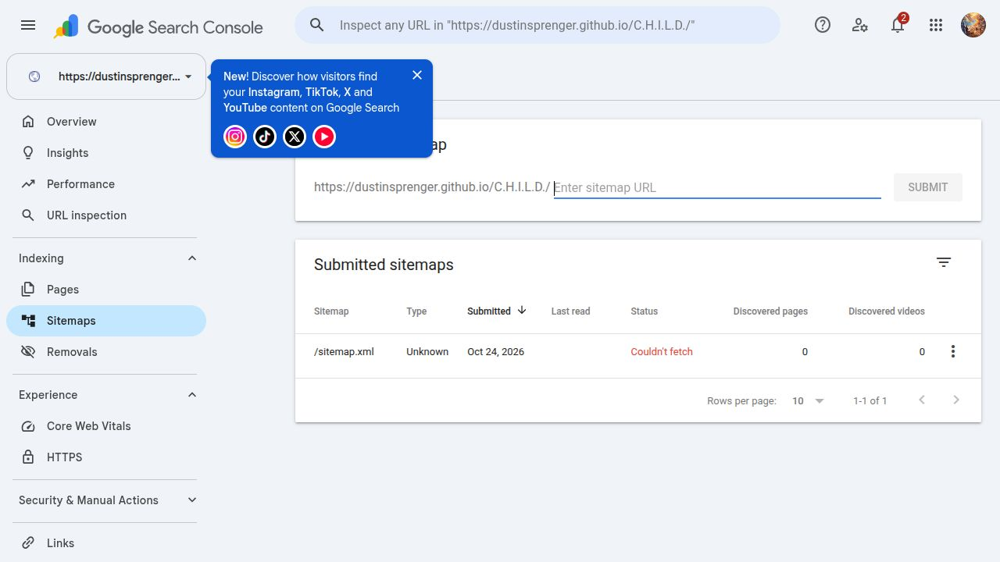
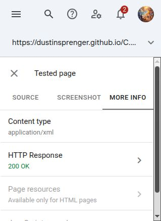
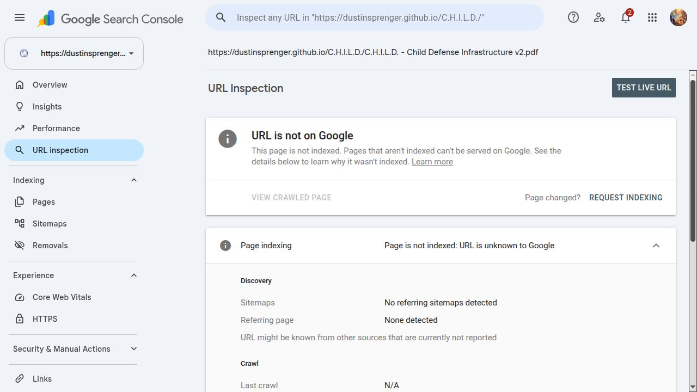
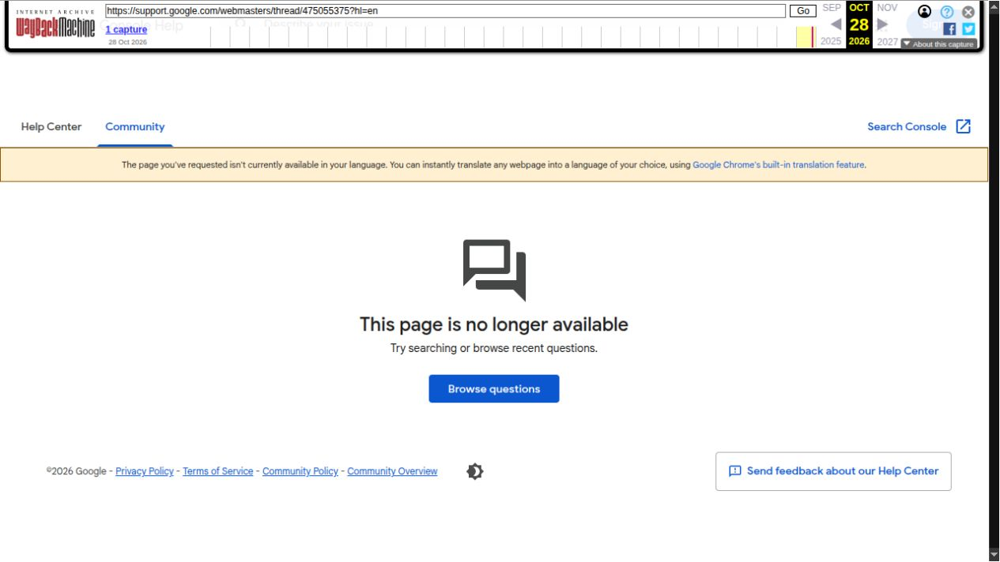
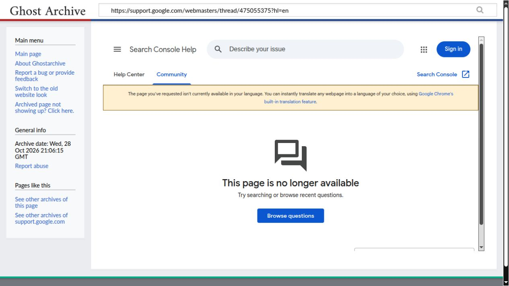

# Google can fetch CHILD’s sitemap. Search Console says “Couldn’t fetch”. Where are the diagnostics?

Dustin Sprenger x ABEL · Evidence recorded 28 October 2026

[Original Google forum post](https://support.google.com/webmasters/thread/475055375?hl=en) · [C.H.I.L.D. project](https://dustinsprenger.github.io/C.H.I.L.D./) · [Research record on OSF](https://osf.io/9m253/)

## Preservation note

Google displayed a successful-posting confirmation, and the complete report remained visible after a signed-in reload. Subsequent independent archive requests received Google’s unavailable-page response instead of the report. A separate request without cookies at 2026-10-28 21:08:24 UTC returned HTTP 410, “Sorry, this page can't be found.” This establishes an access discrepancy in these checks. It does not establish why it occurred: review, automated filtering, delayed public availability, access differences or another cause remain unresolved. No moderation reason was supplied in the inspected signed-in view.

The following direct archive links preserve the unavailable response, not the report’s contents:

- [Wayback direct capture, 2026-10-28 21:06:39 UTC](https://web.archive.org/web/20261028210639/https://support.google.com/webmasters/thread/475055375?hl=en)
- [Ghostarchive direct capture, 2026-10-28 21:06:15 UTC](https://ghostarchive.org/archive/A9Qjv)

This repository copy preserves the report text and its original screenshots so the substance remains inspectable. Any independently verified captures of this public copy will be listed in ARCHIVE-LINKS.txt alongside the direct-attempt record. This is a reproduction by the author, not an independent archive of Google’s original response.

## Published report

Google’s tools can retrieve the files. Search Console still presents a dead end. We are asking for an engineering explanation, not another generic instruction to “check your sitemap.”

We investigated this on 28 October 2026 for C.H.I.L.D., a publicly accessible child-protection research proposal. The PDF is unindexed and the sitemap reports “Couldn’t fetch,” despite successful live inspections. The discrepancy has persisted across our October 24, 25 and 28 checks.

Homepage: https://dustinsprenger.github.io/C.H.I.L.D./
Sitemap: https://dustinsprenger.github.io/C.H.I.L.D./sitemap.xml
PDF: https://dustinsprenger.github.io/C.H.I.L.D./C.H.I.L.D.%20-%20Child%20Defense%20Infrastructure%20v2.pdf
Research record: https://osf.io/9m253/

WHAT WE VERIFIED

1. Google’s PDF live test on October 28 at 15:37:32 America/Chicago (20:37:32 UTC) returned HTTP 200, application/pdf, successful fetch, crawling allowed and indexing allowed. The index report nevertheless says “Page is not indexed: URL is unknown to Google,” with no recorded crawl details.

2. Google’s sitemap live test at 15:39:14 America/Chicago (20:39:14 UTC) returned HTTP 200 and application/xml. The submitted-sitemap report still says “Couldn’t fetch,” type Unknown, zero discovered pages. The list’s last-read field is blank; the detail panel displays October 24.

3. The sitemap is valid XML containing the correct homepage and PDF URLs. We found no redirect, path/case mismatch, malformed space encoding or X-Robots-Tag exclusion. Public fetches at approximately 20:46 UTC also succeeded.

4. Google’s own saved crawled homepage HTML already contains ordinary, direct links to the exact PDF, plus citation_pdf_url. This is not a missing-link or JavaScript-only discovery problem.

5. The PDF is 528,601 bytes, 32 pages and unencrypted. Text extraction completed without errors: 9,040 words on pages 2–32, following an image cover. The downloaded PDF matches our preserved original exactly. Homepage, sitemap and PDF body hashes also match our October 24 captures.

6. The host’s robots.txt returns 404, not a disallow rule. The checked reports show no manual actions or security issues and no removal requests in the displayed six-month records.

7. A separate “Crawled - currently not indexed” report lists the homepage, although current URL Inspection says that homepage is indexed. That exclusion is not a PDF rejection record. The reports are not synchronized.

The PDF indexing request was accepted on October 24 at 19:15:55 UTC. We understand that queue acceptance does not guarantee indexing, and four days is within Google’s published days-to-weeks crawl guidance. We also understand that live inspection and indexing are separate processes. Those distinctions explain why the statuses can coexist; they do not identify the actual cause in this case.

Google’s own sitemap documentation lists low crawl demand among possible fetch-error explanations:
https://support.google.com/webmasters/answer/7451001?hl=en

Its inspection documentation explains the limits of live testing:
https://support.google.com/webmasters/answer/9012289?hl=en

If “Couldn’t fetch” can mean a transport failure, a scheduling decision or incomplete processing, the interface needs to say which. A vague failure label is not a useful diagnosis. Site owners should not have to reverse-engineer Google’s vocabulary before learning whether anything on their site actually needs fixing.

PLEASE ANSWER THE TECHNICAL QUESTIONS

1. Which recorded sitemap attempt failed, at what time, and with what HTTP response, DNS/TLS/timeout error or internal processing status? If no transport failure occurred, please say so.

2. Does this case represent low crawl demand, an unprocessed sitemap, stale reporting or an actual fetch failure? What explains Unknown type, zero discovered pages and the differing last-read fields?

3. What diagnostic can distinguish an outstanding crawl request from a failed or unprocessed one when the URL remains “unknown” and Google’s crawled homepage already contains the link?

4. Can a Product Expert escalate the evidence for an engineering review and identify the responsible Google team or issue reference? Host-level Crawl Stats and robots reports are unavailable through this subfolder property.

We are not claiming that these records prove censorship or intentional suppression. We are documenting an unresolved processing/reporting discrepancy and asking Google to explain it with records rather than reassurance.

The screenshots, response headers, timestamps and SHA-256 comparisons have been preserved. Relevant responses and the absence of a technical explanation will form part of the public record. A forum’s moderation decisions would not erase the independently retained evidence.

An error message should diagnose a problem, not manufacture a dead end.

Dustin Sprenger x ABEL

## Original evidence screenshots

### Sitemap report: Couldn’t fetch

### Google live inspection: HTTP 200, application/xml

### PDF: URL unknown to Google

### Google’s publication confirmation

## Independent archive responses

### Wayback received Google’s unavailable-page response

### Ghostarchive received Google’s unavailable-page response

## Integrity and scope

The original PDF, manuscript, website files and local evidence were preserved. Public copies of the original screenshots are byte-for-byte copies. The complete forum wording is also preserved in forum-post.txt. SHA256SUMS.txt lists hashes for the evidence files in this folder; the README is tracked by Git history.

The indexing investigation establishes a persistent discrepancy between live access and recorded processing status. Its exact cause remains unresolved. No site edits or repeated indexing submissions were made during diagnosis.
